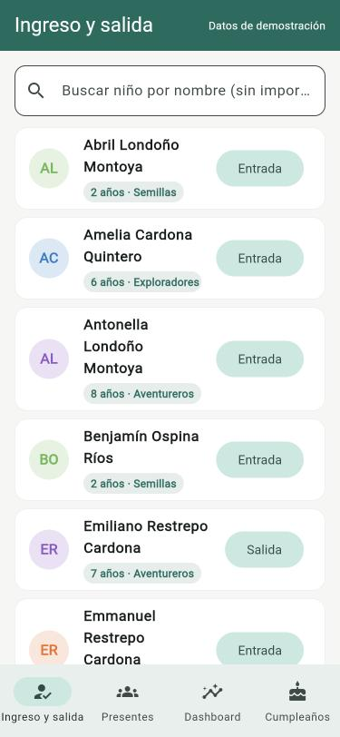
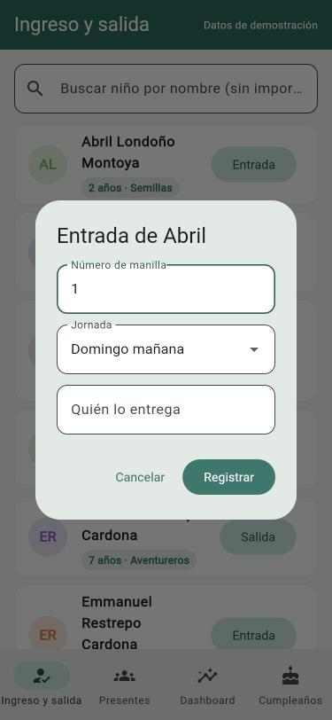
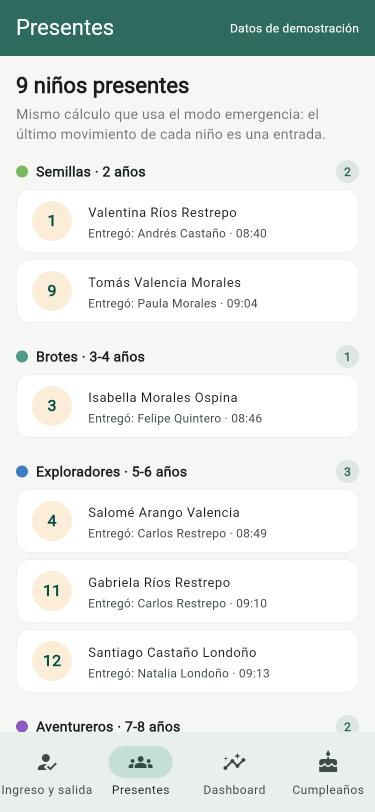
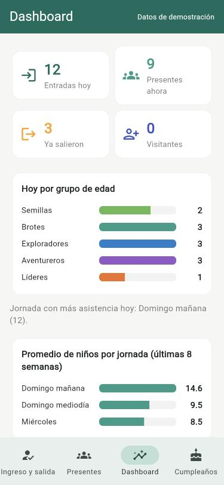
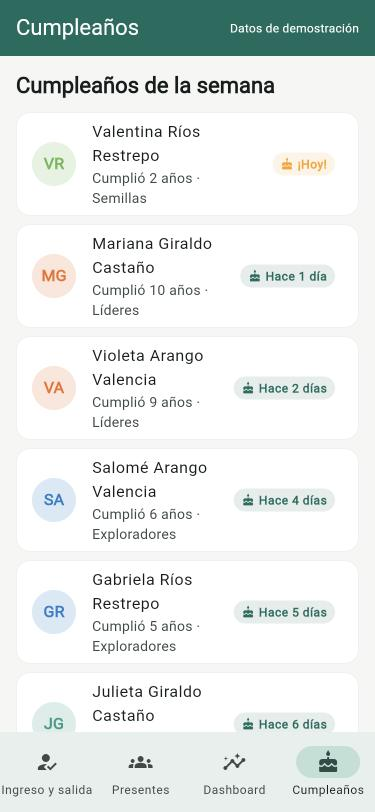

# Asistencia Infantil

App en **Flutter** para controlar la entrada y salida de niños en programas infantiles: búsqueda rápida en la puerta, manillas, alertas médicas, lista de presentes en tiempo real, Dashboard y cumpleaños.

**[Abrir la demo en el navegador](https://geregius.github.io/control-asistencia-infantil/)** (datos ficticios; lo que registres se guarda en tu navegador y el botón ⟳ los reinicia).

[](../../actions/workflows/ci.yml)


> **Repositorio de muestra.** La app completa está en producción (Flutter + Firebase, más de 60 archivos y unas 23.000 líneas de Dart, desde agosto de 2026) y su código es privado porque maneja datos de menores. Aquí se publica una parte representativa: el dominio, la capa de datos y una app de demostración que corre con **datos 100 % ficticios**. Ningún nombre corresponde a una persona real.

## Capturas

| Ingreso y salida | Registrar entrada | Presentes | Dashboard | Cumpleaños |
|---|---|---|---|---|
|  |  |  |  |  |

## Qué hace

- **Ingreso y salida:** busca al niño sin importar tildes ni mayúsculas ("jose" encuentra a "José"), muestra su grupo, alertas médicas y si hay personas que no pueden recogerlo, y registra la entrada con número de manilla.
- **Reglas en la puerta:** no deja entrar dos veces al mismo niño, ni salir a quien no ha entrado, ni repetir una manilla que ya está en uso ese día.
- **Grupo por edad automático:** se calcula con la edad del día, no se guarda fijo.
- **Presentes en tiempo real**, agrupados por grupo de edad. Es el mismo cálculo que usa el modo emergencia de la app completa.
- **Dashboard:** entradas del día, presentes, los que ya salieron, distribución por grupo, promedio por jornada y niños que dejaron de asistir.
- **Cumpleaños de la semana.**
- **Los datos sobreviven a una recarga:** se guardan en el navegador. Un día nuevo empieza limpio, como el cierre automático de jornada de la app real, y el botón ⟳ vuelve a los datos de demostración.

## Probarlo

Requisitos: [Flutter](https://docs.flutter.dev/get-started/install) 3.44 o superior.

```bash
git clone https://github.com/geregius/control-asistencia-infantil.git
cd control-asistencia-infantil
flutter pub get
flutter run -d chrome     # abre la demo en el navegador
flutter test              # 48 pruebas
flutter analyze           # análisis estático
```

Cada cambio a `main` corre el análisis y las pruebas en GitHub Actions y publica la demo en GitHub Pages.

## Estructura

```
lib/
├── domain/            Dart puro: modelos y reglas de negocio
│   ├── nino.dart          Nino, edad, grupo, cumpleaños, búsqueda
│   ├── acudiente.dart     Acudiente y vínculo niño-acudiente
│   ├── registro.dart      Entradas/salidas y cálculo de presentes
│   ├── rol_usuario.dart   Roles y permisos
│   ├── estadisticas.dart  Funciones puras del Dashboard
│   └── fechas.dart        Conversión de fechas sin depender de Firebase
├── data/              Acceso a datos
│   ├── repositorio_asistencia.dart   Contrato (clase abstracta)
│   ├── repositorio_en_memoria.dart   Implementación con las reglas, para demo y pruebas
│   ├── repositorio_persistente.dart  Decorador que guarda los datos en el navegador
│   ├── almacen_local.dart            Dónde se guarda (navegador o memoria)
│   └── datos_demo.dart               Datos ficticios
├── ui/                Pantallas, tema y componentes
└── main.dart
test/                  Pruebas de dominio, datos y widgets
tool/benchmark.dart    Medición de rendimiento del dominio
docs/                  Arquitectura, paradigmas, justificación, rendimiento y capturas
.github/workflows/     Integración continua y publicación de la demo
```

Todo el código está comentado: cada archivo empieza con un encabezado que explica para qué sirve, y cada bloque explica qué hace y por qué.

## Documentación

- [Arquitectura](docs/ARQUITECTURA.md): capas, diagramas y flujo de un ingreso.
- [Paradigmas](docs/PARADIGMAS.md): POO, funcional (`map`, `where`, `fold`, `reduce`) y procedimental, con ejemplos del código.
- [Justificación tecnológica](docs/JUSTIFICACION.md): Flutter frente a Kotlin, React Native y web; Firebase frente a Supabase y servidor propio; trade-offs.
- [Rendimiento](docs/RENDIMIENTO.md): mediciones del dominio, una optimización de 170× y el tamaño de la app web.

## Tecnologías

| | |
|---|---|
| Lenguaje | Dart 3 (null-safety, records, patterns, enums con campos) |
| Interfaz | Flutter, Material 3 |
| App en producción | Firebase: Auth, Firestore, Storage, Cloud Functions, Hosting, Cloud Messaging |
| Calidad | `flutter_lints`, pruebas unitarias y de widgets, GitHub Actions |

## Flujo de trabajo

- Cada cambio se hace en una rama propia (`feat/…`, `fix/…`, `docs/…`, `ci/…`) y entra a `main` por pull request.
- El CI corre `flutter analyze`, `flutter test` y la compilación web en cada pull request; solo se fusiona con todo en verde.
- Al llegar a `main`, el CI publica la demo en GitHub Pages.

## Autor

**Rafael Balaguera** — diseño, desarrollo y decisiones técnicas. La app completa es de su autoría y se donó para el uso de un programa infantil.

El desarrollo se apoyó en [Claude Code](https://claude.com/claude-code) (Anthropic) como asistente de programación.
