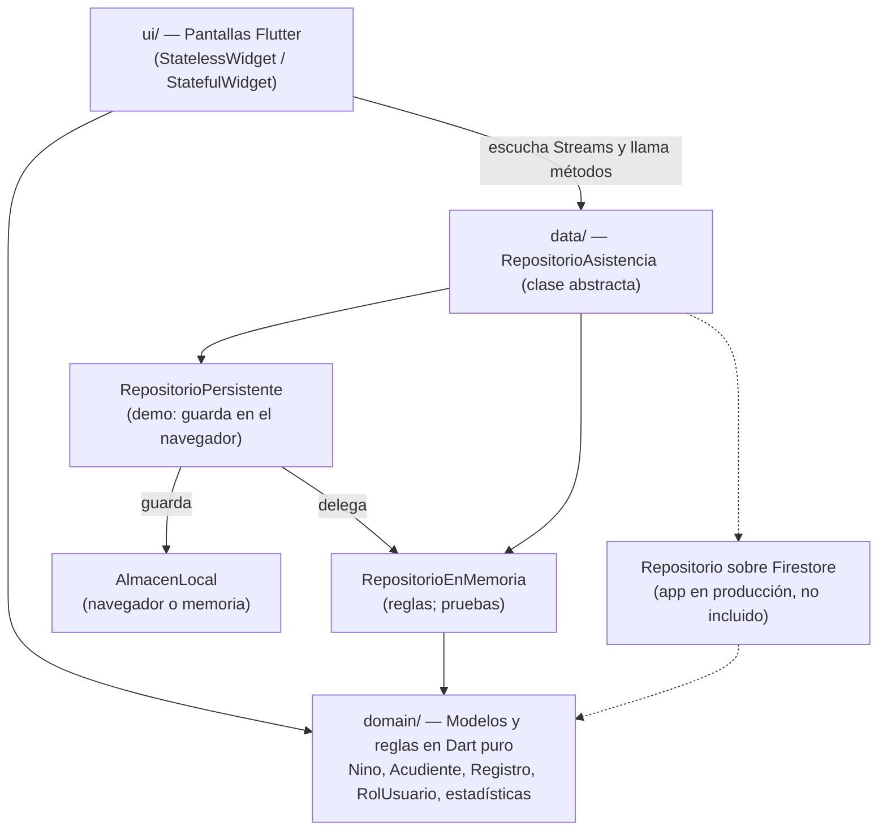
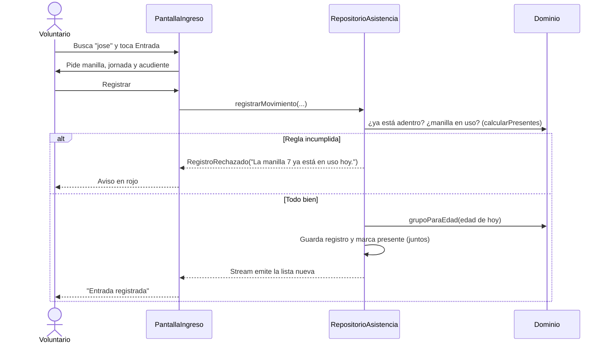

# Arquitectura

La app está dividida en tres capas. Cada una solo conoce a la de abajo.

| Capa | Carpeta | Qué contiene | Depende de |
|---|---|---|---|
| Dominio | `lib/domain/` | Modelos (`Nino`, `Acudiente`, `Registro`), roles y permisos (`RolUsuario`), reglas de negocio (`calcularPresentes`, `grupoParaEdad`) y estadísticas | Nada: solo Dart |
| Datos | `lib/data/` | El contrato `RepositorioAsistencia`, la implementación en memoria, el decorador que guarda en el navegador y los datos ficticios | Dominio |
| Interfaz | `lib/ui/` | Pantallas, tema y componentes visuales | Dominio y el contrato de datos |

## Por qué así

- **El dominio no importa Flutter ni Firebase.** Por eso las 48 pruebas corren en segundos, sin emulador ni internet. La conversión de fechas (`fechas.dart`) acepta el `Timestamp` de Firestore sin depender de su SDK.
- **Las pantallas dependen de una clase abstracta**, no de una base de datos concreta (inversión de dependencias). La demo inyecta `RepositorioPersistente`; las pruebas, `RepositorioEnMemoria`; la app real, uno sobre Firestore. Cambiar de proveedor es escribir otra implementación.
- **Guardar es un decorador, no otra copia de las reglas.** `RepositorioPersistente` implementa el mismo contrato, le delega todo a `RepositorioEnMemoria` y solo agrega "guardar después de cada movimiento". Si la regla rechaza un movimiento, no se guarda nada. Lo guardado de otro día se descarta, como el cierre automático de jornada de la app real.
- **Una sola regla para "quién está presente".** `calcularPresentes()` la usan la lista de presentes, el Dashboard y, en la app real, el modo emergencia (evacuación). Si cada pantalla tuviera su propio cálculo, la lista de una evacuación podría no coincidir con la real.
- **Los datos se reciben como `Stream`.** Las pantallas usan `StreamBuilder`, así que cuando un voluntario registra una entrada, la lista de presentes y el Dashboard se actualizan solos.

## Flujo de un ingreso

## Qué hay en la app completa y no está aquí

Este repositorio es una muestra. La app en producción además tiene:

- Autenticación con Firebase Auth, aprobación de cuentas y recuperación de contraseña.
- Reglas de seguridad de Firestore y Storage por rol.
- Cloud Functions: cierre automático de jornadas, resúmenes mensuales, correos y notificaciones push.
- Fotos con compresión, firma digital en pantalla, escáner QR de manillas, reportes PDF y modo emergencia.
- Programación de turnos de voluntarios, manual de usuario y videotutoriales.

Se dejaron fuera para no exponer la configuración del servidor, las reglas de seguridad ni datos de personas reales.
